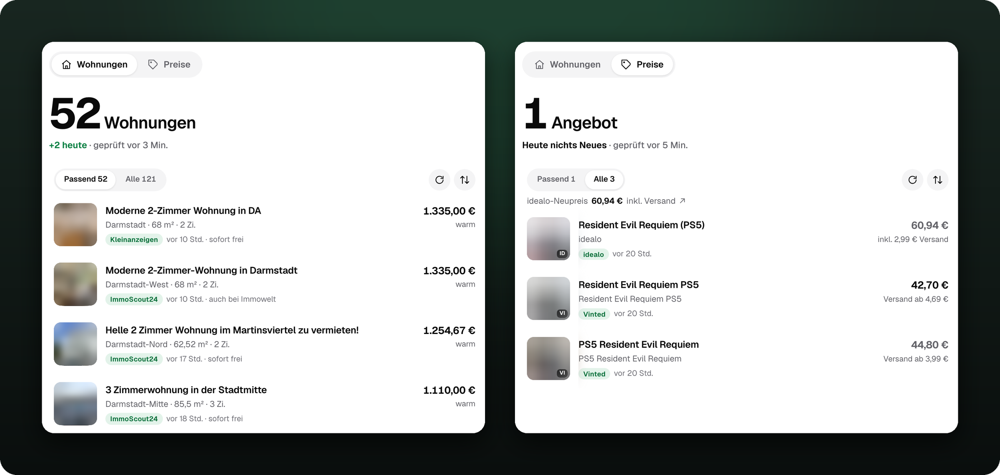
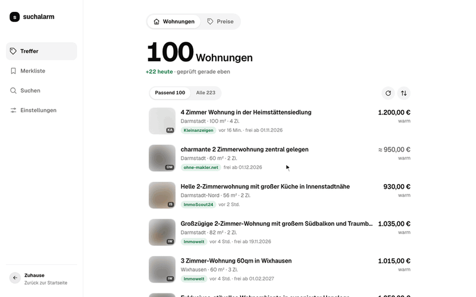

<h1 align="center">SuchAlarm</h1>

<p align="center">
  <b>Self-hosted Wohnungsbot und Preisalarm für Gebrauchtwaren.</b><br>
  Überwacht ImmoScout24, Immowelt, Kleinanzeigen, WG-Gesucht, eBay, Vinted und idealo und meldet neue Treffer per E-Mail.
</p>

<p align="center">
  
  
  
  
</p>

<p align="center">
  
</p>

<p align="center">
  <a href="#schnellstart"><b>Schnellstart</b></a> ·
  <a href="#funktionen"><b>Funktionen</b></a> ·
  <a href="#quellen"><b>Quellen</b></a> ·
  <a href="#konfiguration"><b>Konfiguration</b></a> ·
  <a href="docs/architektur.md"><b>Architektur</b></a>
</p>

**Stichworte:** Wohnungssuche automatisieren · Wohnungsbot · Wohnungsalarm · Immobilien-Scraper · ImmoScout24 Alarm · Kleinanzeigen Alarm · WG-Gesucht Bot · Preisalarm · Preisvergleich gebraucht vs. neu · eBay Preisalarm · Vinted Alarm · Schnäppchen-Finder · Self-hosted · Docker · E-Mail-Benachrichtigung

<p align="center">
  
  <br><sub>Echte Treffer aus dem eigenen Betrieb, Fotos unkenntlich gemacht.</sub>
</p>

## Funktionen

### Wohnungen

| Funktion | Beschreibung |
| --- | --- |
| Eine Suche, alle Portale | Ort, PLZ oder Kreis, Umkreis, Höchstmiete warm, Mindestfläche, Zimmer, Einzugszeitraum |
| Filter | WBS, befristet, Tauschwohnung, WG-Zimmer, eigene Ausschlusswörter, Stadtteile |
| Duplikaterkennung | Dasselbe Inserat auf mehreren Portalen erscheint einmal, auch über das Foto erkannt |
| Warmmiete | Aus der Detailseite oder aus Kalt- und Nebenkosten berechnet, sonst geschätzt und gekennzeichnet |
| Detailblatt | Fakten, Karte, Bewerbungsvorlage, Merkliste „Beworben“ |

### Preise

| Funktion | Beschreibung |
| --- | --- |
| Gebraucht gegen neu | Kleinanzeigen, eBay und Vinted in einer Liste, idealo-Neupreis als Maßstab |
| Echter Endpreis | Versand und Vinted-Käuferschutz eingerechnet; unbekannter Versand zählt nie als 0, Mindestversand wird als „ab“ angezeigt |
| Versand oder Abholung | Abholung im Umkreis der PLZ (10–200 km) mit Ort und Entfernung |
| Kategorien | Videospiele (Plattform), Elektronik, Möbel, Fahrräder, Autos (Erstzulassung, Kilometer, Kraftstoff, Getriebe), Sonstiges |
| Optionen | VB-Angebote, „Zu verschenken“, Mindestpreis gegen Ramsch |

### Für beide

- **Sammelmail** im gewählten Rhythmus, mit Bildern; ein Angebot kommt erst bei einem weiteren Preisrückgang erneut.
- **Kein Doppelversand:** Eine Mail gilt erst als gesendet, wenn der Mailserver sie angenommen hat.
- **Transparenter Quellenstatus:** Gesperrte oder gestörte Quellen werden als gestört angezeigt, nie als „keine Treffer“.
- **Mobil:** Hell- und Dunkelmodus, Wischgesten in der Trefferliste.
- **Tägliche Backups** als geprüfte Generationen.

Details zu Preisgrenzen, Taktung und Mails: [docs/regeln.md](docs/regeln.md).

## Quellen

| Bereich | Quelle | Abruf | Hinweis |
| --- | --- | --- | --- |
| Wohnungen | ImmoScout24 | App-Schnittstelle | bundesweit, auch Kreise |
| Wohnungen | Kleinanzeigen, Immowelt | Browser | bundesweit, keine Kreise |
| Wohnungen | WG-Gesucht | direkt | nur Ortsnamen, keine PLZ |
| Wohnungen | ohne-makler.net, immobilien.de | direkt | ohne Umkreis |
| Wohnungen | NHW, bauverein | direkt | regionaler Bestand (Hessen, Darmstadt) |
| Preise | eBay, Kleinanzeigen, Vinted | Browser | eBay: Sofortkauf, Standort Deutschland |
| Preise | idealo | Browser | Neupreis-Vergleich |

Seiten werden standardmäßig über ein getarntes Firefox ([invisible_playwright](https://github.com/feder-cr/invisible_playwright)) abgerufen. Jeder Abruf läuft durch eine zentrale Taktung je Anbieter.

## Schnellstart

Voraussetzung: Docker. Das Image enthält Firefox und Xvfb und läuft auf `linux/amd64`.

```bash
curl -O https://raw.githubusercontent.com/daaaniel06/SuchAlarm/main/compose.example.yml
mv compose.example.yml compose.yml   # APP_URL eintragen
docker compose up -d
```

Die App läuft danach unter <http://127.0.0.1:8000>. Alternativ ohne Compose:

```bash
docker run -p 127.0.0.1:8000:8000 -v suchalarm-data:/data ghcr.io/daaaniel06/suchalarm
```

Feste Versionen (z. B. `ghcr.io/daaaniel06/suchalarm:1.0.0`) stehen im [CHANGELOG](CHANGELOG.md).

> [!WARNING]
> Suchalarm hat **keine Benutzeranmeldung**. Betrieb nur unter `127.0.0.1` oder in einem privaten Netz (VPN, Tailnet). Für Zugriff von außen ist ein Reverse-Proxy mit Anmeldung erforderlich.

<details>
<summary><b>Selbst bauen</b></summary>

```bash
git clone https://github.com/daaaniel06/suchalarm.git && cd suchalarm
docker build -t suchalarm .
docker run -p 127.0.0.1:8000:8000 -v suchalarm-data:/data suchalarm
```

In `compose.yml` dafür `image:` durch `build: .` ersetzen.
</details>

<details>
<summary><b>Ohne Docker (Linux, Windows)</b></summary>

Voraussetzungen: Python 3.13, Node.js 20+, unter Linux Xvfb. Unter macOS läuft das getarnte Firefox nur im Docker-Image.

```bash
python3.13 -m venv .venv
.venv/bin/pip install -r requirements-dev.txt
.venv/bin/invisible-playwright fetch   # einmalig, ca. 250 MB
npm install
DATA_DIR=./data .venv/bin/uvicorn suchalarm.app:app --host 127.0.0.1 --port 8000
```
</details>

## Konfiguration

Suchen, Empfänger, Mail-Rhythmus und Quellen werden in der Oberfläche eingestellt und in SQLite gespeichert.

| Variable | Standard | Bedeutung |
| --- | --- | --- |
| `DATA_DIR` | `/data` | Datenbanken, Bilder, Backups |
| `APP_URL` | – | Link zur App in den Mails |
| `SMTP_HOST`, `SMTP_PORT` | –, `587` | Mailserver fest vorgeben (optional) |
| `SMTP_SECURITY` | `starttls` | `starttls` oder `ssl` |
| `SMTP_USER`, `SMTP_PASSWORD`, `SMTP_FROM` | – | Anmeldung und Absender |
| `FORWARDED_ALLOW_IPS` | `127.0.0.1` | Vertrauenswürdige Reverse-Proxys |

### E-Mail einrichten

1. **Einstellungen → Mails → Mailserver → Einrichten.** Für Gmail, GMX, Web.de, iCloud, Posteo, mailbox.org und T-Online wird der Server automatisch eingetragen.
2. Passwort eingeben. Gmail und iCloud benötigen ein [App-Passwort](https://myaccount.google.com/apppasswords).
3. Empfänger hinzufügen, Testmail senden.

Das Passwort wird nie an den Browser ausgeliefert. Alternativ die `SMTP_*`-Variablen in `compose.yml` setzen; dann bleibt es außerhalb der Datenbank.

## Betrieb

| Thema | Kurz |
| --- | --- |
| Backups | Täglich nach `/data/backups/<Datum>/`, geprüft (`integrity_check`), mit `manifest.json`, sieben Generationen. Wiederherstellen: App stoppen, `.db`-Dateien nach `/data/` kopieren, starten. Zusätzlich extern sichern. |
| Deploy | Zuerst die Test-Stage bauen und ausführen (`docker build --target test .`), dann das Image. Images mit Commit-SHA taggen. |
| Rollback | Auf einen vorhandenen SHA-Tag zurückgehen; vor Schemaänderungen Daten sichern. |
| Zugriff | Nur der Reverse-Proxy veröffentlicht einen Port; schreibende Anfragen fremder Origins werden abgewiesen. |

## Entwicklung

```bash
./scripts/check.sh                    # ruff, mypy, prettier, eslint, alle Tests
./scripts/check.sh --fix              # vorher formatieren
git config core.hooksPath .githooks   # check.sh vor jedem Commit
```

| Aufgabe | Befehl |
| --- | --- |
| Python-Tests | `.venv/bin/python -m unittest discover -s tests -p 'test_*.py'` |
| Frontend-Tests | `npm test` |
| Browser-Test | einmalig `.venv/bin/playwright install chromium` |
| Abhängigkeiten | `requirements.in` ändern, dann `.venv/bin/pip-compile --strip-extras --no-emit-index-url requirements.in` |

**Stack:** FastAPI mit Hintergrund-Worker auf derselben Event-Loop, SQLite, Frontend als ES-Module ohne Build-Schritt. Der Kern (`suchalarm/core/`) kennt keine Suchart; Wohnungen und Preise sind eigenständige Fachmodule.

Weitere Dokumente: [Architektur](docs/architektur.md) · [Fachregeln](docs/regeln.md) · [Design](DESIGN.md) · [Mitmachen](CONTRIBUTING.md) · [Regeln für Codeänderungen](AGENTS.md)

## Grundsätze

- **Rücksicht auf Anbieter:** Taktung je Anbieter, geteilte Abfragen für gleiche Suchen, Pause bei Sperren, keine CAPTCHA-Umgehung.
- **Nur beobachten:** Suchalarm kauft nichts, bewirbt sich nicht und kontaktiert keine Anbieter.

## Haftungsausschluss

Suchalarm ist ein privates Projekt ohne Verbindung zu den genannten Anbietern. Viele Anbieter untersagen in ihren Nutzungsbedingungen den automatisierten Abruf; das getarnte Firefox und die App-Schnittstelle umgehen bewusst die Erkennung automatisierter Zugriffe. Der Einsatz erfolgt in eigener Verantwortung: Nutzungsbedingungen beachten, Taktung nicht verschärfen, Treffer nicht weiterverbreiten. Ohne Gewähr.

## Lizenz

[PolyForm Noncommercial 1.0.0](LICENSE): Nutzung, Betrieb, Änderung und Weitergabe für private und gemeinnützige Zwecke. Keine kommerzielle Nutzung. „Source available“, nicht Open Source im Sinne der OSI.
