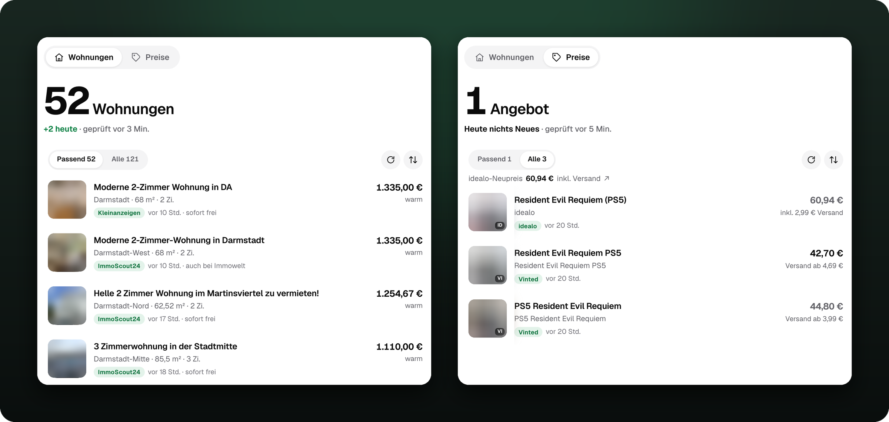
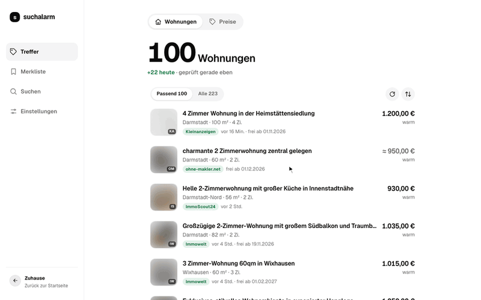

<h1 align="center">SuchAlarm: Wohnungsbot &amp; Preisalarm für Gebrauchtwaren</h1>

<p align="center">
  <b>Dein eigener Alarm für neue Wohnungen und günstige Gebrauchtwaren.</b><br>
  Selbst gehosteter Wohnungsbot für ImmoScout24, Immowelt, Kleinanzeigen und WG-Gesucht, dazu Preisvergleich und Preisalarm für Gebrauchtwaren: vergleicht Kleinanzeigen, eBay und Vinted, gleicht mit dem Neupreis auf idealo ab und meldet Schnäppchen unter deinem Wunschpreis. Prüft die Portale im Hintergrund und meldet sich per Mail.
</p>

<p align="center">
  
  
  
</p>

<p align="center">
  
</p>

- 🔎 **Wohnungen oder alles andere:** Möbel, Videospiele, Kleidung, Fahrräder, Autos, mit Versand oder zur Abholung in deiner Nähe.
- 🔔 **Neue Treffer kommen per Mail**, alle Portale in einer Liste.
- ♻️ **Gebraucht gegen neu verglichen:** Angebote von Kleinanzeigen, eBay und Vinted in einer Liste, daneben der günstigste Neupreis auf idealo.
- 💶 **Nur was ins Budget passt**, gerechnet mit Versand bzw. Warmmiete.

<p align="center">
  <a href="#schnellstart"><b>Schnellstart</b></a> ·
  <a href="#was-es-kann"><b>Funktionen</b></a> ·
  <a href="#quellen"><b>Quellen</b></a> ·
  <a href="docs/architektur.md"><b>Architektur</b></a>
</p>

## Warum es Suchalarm gibt

Ich war auf Wohnungssuche und wollte nebenbei gebrauchte PS5-Spiele billig snipen. Keine Lust, ständig alle Portale abzuklappern, also macht das jetzt Suchalarm und schickt mir eine Mail, wenn was passt.

<p align="center">
  
  <br><sub>Beispieldaten, keine echten Angebote.</sub>
</p>

kurzer non slop kommentar von mir: für deine eigenen nutzen könnte es ein wenig nachbesserung benötigen. eine claude session von 30min sollte alles so anpassen das es deine bedürfnisse befriedigt. peace 

## Was es kann

Suchalarm vereint zwei Bereiche in einer App, umschaltbar oben in der Oberfläche: einen **Wohnungsbot** für die Wohnungssuche und einen **Preisalarm** für gebrauchte und neue Sachen.

### Wohnungen

- **Eine Suche, alle Portale:** Ort oder PLZ mit Umkreis, Höchstmiete warm, Mindestfläche und -zimmer, Einzugszeitraum.
- **Störendes raus:** WBS, befristet, Tauschwohnung und WG-Zimmer ausblendbar, dazu eigene Ausschlusswörter.
- **Duplikate erkannt:** dasselbe Inserat auf mehreren Portalen erscheint einmal, auch wenn nur das Foto gleich ist.
- **Warmmiete im Blick:** angegebene Warmmiete aus der Detailseite; fehlt sie, schätzt Suchalarm sie aus der Kaltmiete. Immowelts eigene Schätzung zählt nicht.
- **Detailblatt:** Fakten, Karte, Bewerbung mit Vorlage und Merkliste „Beworben“.

### Preise für Gebrauchtwaren

Der Preisalarm ist vor allem ein Preisvergleich für Gebrauchtwaren mit Preisüberwachung: Er schaut auf den großen Gebrauchtmärkten nach deinem Artikel, rechnet alle Angebote auf einen vergleichbaren Endpreis um und zeigt, was gebraucht wirklich günstiger ist als neu. Fällt ein Angebot unter deinen Wunschpreis, kommt eine Mail, oft bevor andere das Schnäppchen sehen.

- **Gebrauchtmärkte nebeneinander:** Kleinanzeigen, eBay (Sofortkauf) und Vinted in einer Liste, nach Neuheit oder Endpreis sortierbar.
- **Neupreis als Maßstab:** idealo liefert den günstigsten Shoppreis. Ist ein neuer Artikel sogar billiger als jedes Gebrauchtangebot, steht das mit der Ersparnis in der Mail.
- **Für alles Mögliche:** Kategorien für Videospiele, Elektronik, Möbel, Fahrräder und Autos, dazu „Sonstiges“ für alles andere wie Kleidung oder Spielzeug.
- **Versand, Abholung oder beides:** Pro Suche wählbar. Bei Abholung sucht Suchalarm auf eBay und Kleinanzeigen im Umkreis deiner PLZ (10–200 km) und zeigt Ort und Entfernung. Bei Möbeln und Fahrrädern ist das voreingestellt.
- **Ein Preis, der stimmt:** Versand pro Suche ein- oder ausschließbar; unbekannter Versand zählt nie als 0. Bei Vinted ist der Käuferschutz eingerechnet.
- **Kategorien mit eigenen Filtern:** Plattform bei Videospielen, Erstzulassung und Kilometer bei Autos, VB und „Zu verschenken“.

### Für beide

- **Mails ohne Flut:** gesammelt im gewählten Rhythmus, mit Bildern; ein Angebot kommt erst bei einem weiteren Preisrückgang wieder.
- **Ehrlicher Status:** gesperrte oder gestörte Quellen werden als solche angezeigt, nie als „keine Treffer“.
- **Mobil bedienbar:** helles und dunkles Design, Wischgesten in der Trefferliste.

Die genauen Regeln (Preisgrenzen, Taktung, Grenzen der Quellen, Mails, Bilder) stehen in [docs/regeln.md](docs/regeln.md).

## Quellen

| Bereich | Quelle | Abruf |
| --- | --- | --- |
| Wohnungen | ImmoScout24 | App-Schnittstelle |
| Wohnungen | Kleinanzeigen, Immowelt | Browser |
| Wohnungen | WG-Gesucht, NHW, bauverein | direkt |
| Preise | eBay (Sofortkauf, gebraucht, Standort Deutschland) | Browser |
| Preise | Kleinanzeigen, Vinted | Browser |
| Preise | idealo (Neupreis-Vergleich) | Browser |

Seiten laufen standardmäßig über ein getarntes Firefox. Direkte Abrufe gibt es nur dort, wo sie ohne Mehraufwand gehen, etwa bei Vorschaubildern und App-Schnittstellen. Jeder Abruf läuft durch dieselbe zentrale Taktung.

**Regionale Grenzen:** ImmoScout24, Kleinanzeigen, Immowelt und WG-Gesucht funktionieren bundesweit. Immowelt liest die neuesten Inserate, schon nach Miete, Fläche und Zimmern vorgefiltert. WG-Gesucht sucht nur nach Ortsnamen, nicht nach Postleitzahl, und liest Wohnungen und 1-Zimmer-Wohnungen mit Höchstmiete, Mindestfläche und -zimmern; die Orts-ID holt Suchalarm einmal über WG-Gesuchts eigene Ortssuche und merkt sie sich. NHW und bauverein haben ohnehin nur Bestand in der Region.

## Schnellstart

Am einfachsten mit Docker und dem fertigen Image. Es bringt das getarnte Firefox ([invisible_playwright](https://github.com/feder-cr/invisible_playwright)) samt Xvfb mit, läuft als Benutzer mit UID 10001 und gibt es für `linux/amd64`.

```bash
curl -O https://raw.githubusercontent.com/daaaniel06/SuchAlarm/main/compose.example.yml
mv compose.example.yml compose.yml   # APP_URL eintragen
docker compose up -d
```

Danach läuft die App unter <http://127.0.0.1:8000>. Ohne Compose geht es auch direkt:

```bash
docker run -p 127.0.0.1:8000:8000 -v suchalarm-data:/data ghcr.io/daaaniel06/suchalarm
```

Die Versionen stehen im [CHANGELOG](CHANGELOG.md); statt `latest` lässt sich eine feste Version wie `ghcr.io/daaaniel06/suchalarm:1.0.0` verwenden.

> [!WARNING]
> Suchalarm hat **keine Benutzeranmeldung**. Wer die Oberfläche erreicht, kann Suchen, Empfänger und Einstellungen ändern. Die App gehört deshalb nur an `127.0.0.1` oder in ein privates Netz (VPN, Tailnet), nie ungeschützt ins Internet. Wer sie trotzdem von außen erreichbar machen will, braucht davor einen Reverse-Proxy mit Anmeldung.

### Selbst bauen

```bash
git clone https://github.com/daaaniel06/suchalarm.git && cd suchalarm
docker build -t suchalarm .
docker run -p 127.0.0.1:8000:8000 -v suchalarm-data:/data suchalarm
```

In `compose.yml` dafür `image:` durch `build: .` ersetzen.

### Ohne Docker

**Voraussetzungen:** Python 3.13, Node.js 20+ und Linux oder Windows; unter Linux braucht es Xvfb, unter macOS läuft das getarnte Firefox nur im Docker-Image.

```bash
python3.13 -m venv .venv
.venv/bin/pip install -r requirements-dev.txt
.venv/bin/invisible-playwright fetch   # einmalig, lädt die Browser-Engine (~250 MB)
npm install

DATA_DIR=./data .venv/bin/uvicorn suchalarm.app:app --host 127.0.0.1 --port 8000
```

Ohne Browser startet die App trotzdem; Abrufe schlagen dann fehl und werden später erneut versucht.

## Konfiguration

Alles Weitere (Mailserver, Empfänger, Mail-Rhythmus, Quellen) stellt man in der Oberfläche ein und es liegt in SQLite.

| Variable | Standard | Bedeutung |
| --- | --- | --- |
| `DATA_DIR` | `/data` | Datenverzeichnis für Datenbanken, Bilder und Backups |
| `APP_URL` | – | Link zur App in den Mails |
| `SMTP_HOST`, `SMTP_PORT` | –, `587` | Mailserver fest vorgeben (optional, sonst in der Oberfläche) |
| `SMTP_SECURITY` | `starttls` | `starttls` oder `ssl` |
| `SMTP_USER`, `SMTP_PASSWORD`, `SMTP_FROM` | – | Anmeldung und Absender |
| `FORWARDED_ALLOW_IPS` | `127.0.0.1` | Adressen von Reverse-Proxys, deren `X-Forwarded-*`-Header gelten (Uvicorn), etwa das Docker-Netz des Proxys |

Secrets werden nie über die API ausgeliefert.

### Mailversand einrichten

Alles geht in der App unter **Einstellungen → Mails**:

1. Bei **Mailserver** auf **Einrichten** tippen und die Adresse des Postfachs eingeben, über das die Mails rausgehen. Für Gmail, GMX, Web.de, iCloud, Posteo, mailbox.org und T-Online trägt Suchalarm den Server selbst ein; bei anderen Anbietern steht er in deren Hilfe, oft unter „SMTP“ oder „E-Mail-Programm einrichten“ (etwa `smtp.beispiel.de:587`, Port 465 geht auch).
2. Das Passwort eingeben. Gmail und iCloud wollen dafür ein eigenes App-Passwort, bei Gmail unter [App-Passwörter](https://myaccount.google.com/apppasswords) (vorher die Bestätigung in zwei Schritten einschalten).
3. Empfänger hinzufügen und eine Testmail senden.

Jedes Feld wird beim Verlassen gespeichert. Das Passwort liegt in der Datenbank im Datenverzeichnis (auch in deren Backups) und wird nie an den Browser zurückgegeben. Wer Adresse oder Server ändert, muss das Passwort neu eingeben, damit es nie an einen anderen Server geht.

**Fest vorgeben:** Steht `SMTP_HOST` in `compose.yml`, gelten die `SMTP_*`-Variablen aus der Tabelle oben, und die Oberfläche zeigt den Mailserver nur an. So bleibt das Passwort außerhalb der Datenbank:

```yaml
SMTP_HOST: smtp.gmail.com
SMTP_PORT: '587'
SMTP_SECURITY: starttls
SMTP_USER: deine.adresse@gmail.com
SMTP_PASSWORD: das-app-passwort
SMTP_FROM: Suchalarm <deine.adresse@gmail.com>
```

## Entwicklung

```bash
./scripts/check.sh                    # ruff, mypy, prettier, eslint, alle Tests
./scripts/check.sh --fix              # vorher formatieren
git config core.hooksPath .githooks   # check.sh vor jedem Commit
```

Dieselben Checks (ohne Frontend und Browser-Test) laufen beim Deploy in der Test-Stage des Dockerfiles.

| Aufgabe | Befehl |
| --- | --- |
| Python-Tests | `.venv/bin/python -m unittest discover -s tests -p 'test_*.py'` |
| Frontend-Tests | `npm test` (reine Funktionen aus `static/logic.js`, `node --test`) |
| Browser-Test | braucht einmalig `.venv/bin/playwright install chromium` |
| Abhängigkeiten | in `requirements.in` ändern, dann `.venv/bin/pip-compile --strip-extras --no-emit-index-url requirements.in` |

Weitere Dokumente:

- [CONTRIBUTING.md](CONTRIBUTING.md): Mitmachen
- [AGENTS.md](AGENTS.md): Regeln für Änderungen am Code
- [DESIGN.md](DESIGN.md): Designsystem
- [docs/regeln.md](docs/regeln.md): Fachregeln im Detail
- [docs/architektur.md](docs/architektur.md): Aufbau im Detail

## Architektur

Eine FastAPI-App mit einem Hintergrund-Worker auf derselben Event-Loop, Daten in SQLite, Oberfläche als ES-Module ohne Build-Schritt.

```text
suchalarm/
├── core/       Taktung, Browser, HTTP, Bilder – kennt keine Suchart
├── preis/      Fachmodul Preise: Quellen, Regeln, Tabellen, Mail
├── wohnung/    Fachmodul Wohnungen: Portale, Details, Duplikate, Karten, Mail
├── static/     Oberfläche (HTML, CSS, JS)
├── kinds.py    Verzeichnis der Sucharten
├── worker.py   gemeinsamer Ablauf: prüfen, speichern, Mails, Backup
├── app.py      API
└── store.py    gemeinsame Datenbank
```

Der Kern importiert nichts aus den Fachmodulen. Jede Suchart liefert dieselben Schritte (`prepare`, `fetch`, `save`, `take_pending` …), eigene Tabellen in einer eigenen Datenbankdatei und ihr eigenes Mail-Layout. Eine neue Suchart braucht deshalb keine Änderung an API, Worker oder Mailer. Details stehen in [docs/architektur.md](docs/architektur.md).

## Betrieb

Gedacht ist Suchalarm für einen eigenen Server im privaten Netz, hinter einem Reverse-Proxy wie Caddy.

- **Deploy:** Vor jedem neuen Image die Test-Stage bauen (`docker build --target test .` und starten: ruff, mypy, Tests ohne Netzwerk), erst danach das Image und den Dienst aktualisieren. Images mit dem Commit-SHA taggen, dann ist ein Rollback nur ein Tag-Wechsel.
- **Rollback:** auf einen vorhandenen SHA-Tag zurückgehen; vor Schemaänderungen Daten sichern.
- **Backups:** täglich über die SQLite-Backup-API nach `/data/backups/`, sieben Tage aufbewahrt. Gegen Datenträgerverlust zusätzlich extern sichern.
- **Zugriff:** keine Benutzeranmeldung (siehe Warnung im Schnellstart). Schreibende Anfragen fremder Origins werden abgewiesen. Nur der Proxy sollte einen Port veröffentlichen; `FORWARDED_ALLOW_IPS` auf dessen Adresse setzen.

## Grundsätze

- **Rücksicht auf die Anbieter:** zentrale Taktung je Anbieter, gemeinsame Abfragen für gleiche Suchen, Pause bei Sperren, kein Lösen von CAPTCHAs.
- **Nur beobachten:** Suchalarm kauft nichts, bewirbt sich nicht selbst und schreibt keinen Anbietern.
- **Eine Mail gilt erst als gesendet, wenn der Mailserver sie angenommen hat.**

## Hinweis zur Nutzung

Suchalarm ist ein privates Projekt für den eigenen Gebrauch. Es steht in keiner Verbindung zu den genannten Anbietern. Viele von ihnen untersagen in ihren Nutzungsbedingungen den automatisierten Abruf ihrer Seiten. Das getarnte Firefox und die App-Schnittstelle umgehen dabei bewusst die Erkennung automatisierter Zugriffe, auch wenn keine CAPTCHAs gelöst werden. Ob und wie du Suchalarm einsetzt, liegt in deiner Verantwortung: Nutzungsbedingungen der Anbieter beachten, die Taktung nicht verschärfen und Treffer nicht weiterverbreiten. Ohne Gewähr; Anbieter können ihre Seiten jederzeit ändern oder Zugriffe sperren.

## Lizenz

[PolyForm Noncommercial 1.0.0](LICENSE): Lesen, selbst betreiben, verändern und weitergeben ist für private und gemeinnützige Zwecke erlaubt. Kommerzielle Nutzung, zum Beispiel als bezahlter Dienst oder in einem Produkt, ist nicht erlaubt. Suchalarm ist damit „source available“, nicht Open Source im Sinne der OSI.
